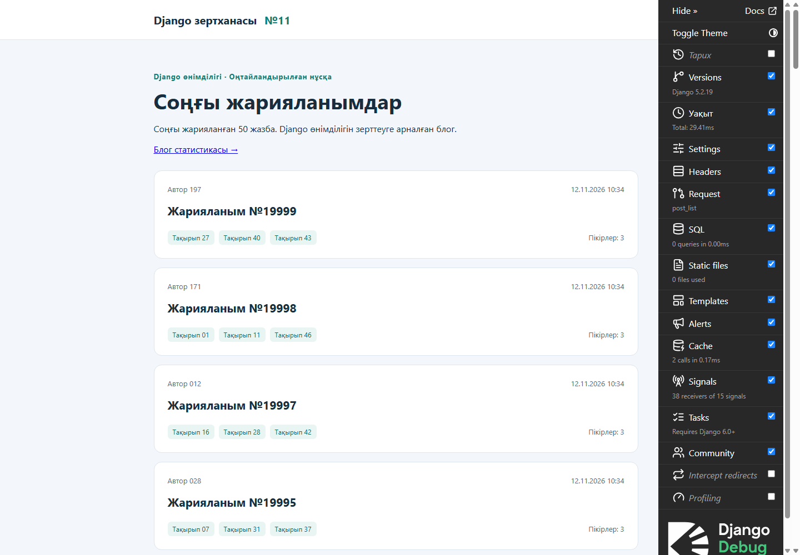
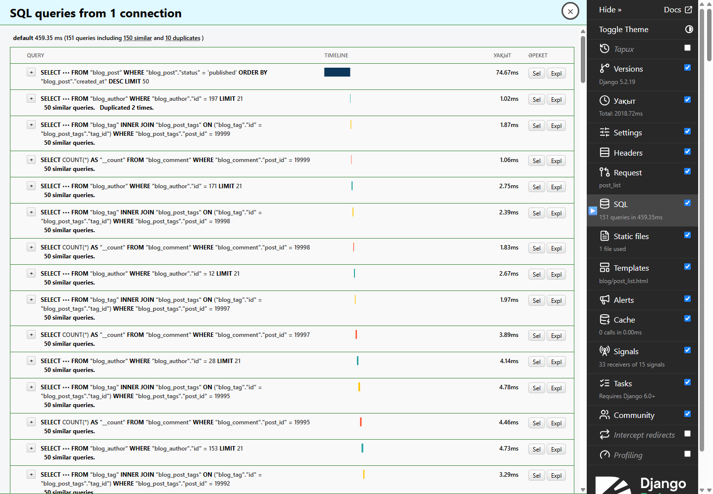
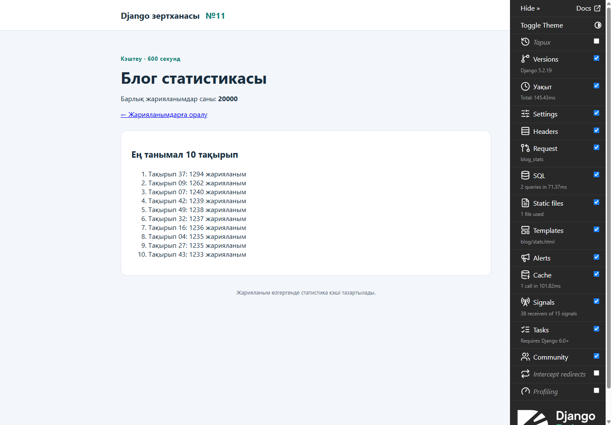
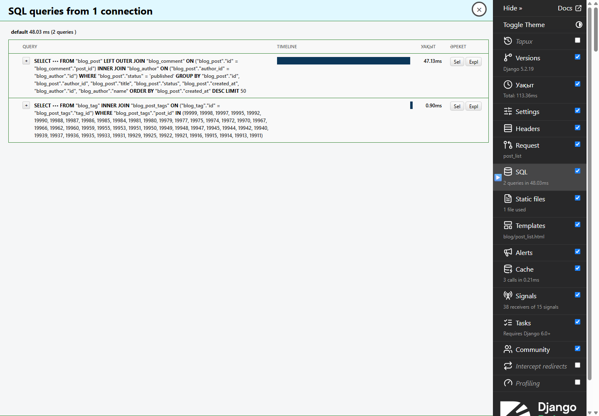
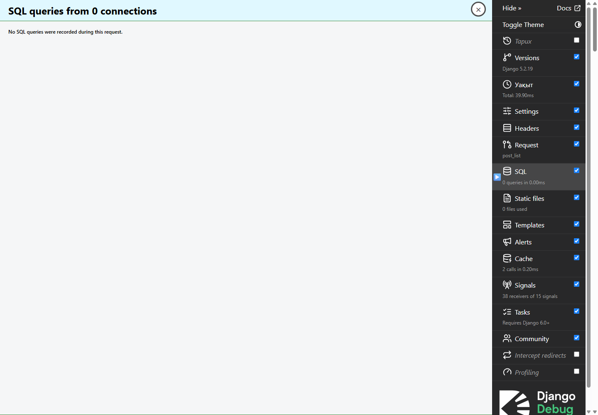

# №11 зертханалық жұмыс
Django өнімділігі

Орындаған: Қали Диханбай. Күні: 12.11.2026.

## Тақырыбы және мақсаты

Django блогының өнімділігін өлшеу, N+1 мәселесін анықтау, байланысты деректерді тиімді алу, SQL орындалу жоспарын талдау және кэштеудің әсерін тәжірибе арқылы тексеру.

## Жобаның сипаттамасы және деректер саны

Жоба: django_lab11_performance. Орта: Windows 11, VS Code, Python 3.14.3, Django 5.2.19, SQLite, HTML және CSS. /posts/ беті соңғы жарияланған 50 жазбаны көрсетеді. /stats/ бетінде блог статистикасы берілген.

| Нысан | Саны |
| --- | --- |
| Автор | 200 |
| Тақырып | 50 |
| Жарияланым | 20 000 (жарияланғаны 10 076) |
| Пікір | 60 000 |
| Жарияланым-тақырып байланысы | 60 000; әр жазбада 3 тақырып |

Деректер random.seed(42) және bulk_create арқылы жасалған. Барлық өлшеу бір компьютердегі бір SQLite базасында орындалды. Жұмыс соңында бес кестенің SHA256 бақылау сомалары бастапқы мәндерімен бірдей болды.

1-сурет. Оңтайландырылған жарияланымдар беті.



## LOGGING және perf.log

TimingMiddleware time.perf_counter() арқылы уақытты өлшейді, CaptureQueriesContext(connection) арқылы SQL санын есептейді. logging.getLogger("perf") әдісі сұрау әдісін, URL, миллисекундпен уақытты және SQL санын perf.log файлына жазады. 300 мс-тан жоғары уақыт WARNING, қалғаны INFO деңгейімен тіркеледі. Файл Git құрамына кірмейді.

```text
GET /posts/ duration_ms=44.773 sql_queries=2
GET /posts/ duration_ms=0.592 sql_queries=0
```

Бұл екі жол нақты журналдан алынды; олар бес өлшемдік салыстырмалы серияның орнына қолданылмайды.

## Django Debug Toolbar

django-debug-toolbar 8.0.0 орнатылды. INSTALLED_APPS, MIDDLEWARE, INTERNAL_IPS және /__debug__/ маршруттары бапталды. SQL панелін тікелей тексеру бастапқы нұсқада 151 сұрауды көрсетті. Панельдің нақты өлшемі: 157,704 мс SQL уақыты; браузер суреті бөлек сұраудан алынған.

2-сурет. SQL панелі: 151 сұрау және қайталанатын байланысты сұраулар.



PostListTests тестіндегі assertNumQueries(2) оңтайландыруға дейін әдейі орындалмады: 151 != 2. Нақты хаттама evidence/step3-expected-failure.txt файлында сақталған.

## N+1 мәселесін шешу

Бастапқы бетте негізгі сұрауға қоса 50 автор, 50 тақырып тізімі және 50 пікір саны жеке сұралды: 1 + 50 + 50 + 50 = 151. Өзгерістер ретімен енгізіліп, әрқайсысынан кейін бес рет өлшенді.

| Өзгеріс | SQL саны | SQL медианасы, мс | Бет медианасы, мс |
| --- | --- | --- | --- |
| Бастапқы нұсқа (қайта өлшеу) | 151 | 140,003 | 438,301 |
| Авторды select_related арқылы алу | 101 | 120,729 | 341,320 |
| Тегтерге prefetch_related қосу | 52 | 110,763 | 263,007 |
| Пікір санын annotate арқылы алу | 2 | 150,846 | 206,265 |
| N+1 түзетілген, body кейінге қалдырылған | 2 | 57,134 | 106,138 |

```text
def posts_queryset():
    return (Post.objects
        .select_related("author")
        .prefetch_related("tags")
        .annotate(n_comments=Count("comments"))
        .defer("body")
        .filter(status="published")
        .order_by("-created_at")[:50])

Шаблон: {{ p.n_comments }}
```

select_related авторды JOIN арқылы алды. prefetch_related барлық көрсетілетін жазбалардың тақырыптарын екінші сұрауда алды. annotate әр жазбаның пікір санын негізгі сұрауда есептеді. defer бетте көрсетілмейтін body өрісін жүктемеді.

Сұраулар саны нақты 151 → 101 → 52 → 2 → 2 болды. Сан азайғанымен, агрегацияның өзіндік құны бар: сондықтан SQL уақытын және толық жауап уақытын бөлек салыстыру қажет. assertNumQueries(2) тесті оңтайландырудан кейін өтті.

## EXPLAIN нәтижелері және индекс

SQLite жүйесінде QuerySet.explain() EXPLAIN QUERY PLAN нәтижесін береді. Алдымен индекске дейінгі жоспар сақталды, содан кейін Post.Meta.indexes арқылы құрама индекс қосылып, миграция қолданылды.

```text
models.Index(
    fields=["status", "-created_at"],
    name="post_status_created_idx",
)

python manage.py makemigrations blog
python manage.py migrate
```

## Индекске дейінгі нақты жоспар

```text
10 0 216 SCAN blog_post
14 0 45 SEARCH blog_author USING INTEGER PRIMARY KEY (rowid=?)
17 0 53 SEARCH blog_comment USING COVERING INDEX blog_comment_post_id_580e96ef (post_id=?) LEFT-JOIN
74 0 0 USE TEMP B-TREE FOR ORDER BY
```

## Индекстен кейінгі нақты жоспар

```text
11 0 61 SEARCH blog_post USING INDEX post_status_created_idx (status=?)
18 0 45 SEARCH blog_author USING INTEGER PRIMARY KEY (rowid=?)
21 0 53 SEARCH blog_comment USING COVERING INDEX blog_comment_post_id_580e96ef (post_id=?) LEFT-JOIN
78 0 0 USE TEMP B-TREE FOR ORDER BY
```

Негізгі өзгеріс: SCAN blog_post орнына SEARCH blog_post USING INDEX post_status_created_idx (status=?) қолданылды. Агрегациясы бар толық сұрауда USE TEMP B-TREE FOR ORDER BY сақталды. Тек status сүзгісі мен created_at сұрыптауы бар базалық сұрауда уақытша сұрыптау жойылды. Толық SQL және екі базалық жоспар evidence/explain_before.txt және evidence/explain_after.txt файлдарында бар.

| Күйі | SQL саны | SQL медианасы, мс | Бет медианасы, мс |
| --- | --- | --- | --- |
| Индекске дейін | 2 | 57,134 | 106,138 |
| Индекстен кейін | 2 | 47,191 | 81,378 |

## Кэштеу және статистиканы жаңарту

LocMemCache бір Python процесінің жадында жұмыс істейді. /posts/ бетіне @cache_page(60) қосылды. Статистика бөлек /stats/ бетінде көрсетіледі: барлық жарияланым саны және ең танымал 10 тақырып. Осылайша /posts/ бетіндегі екі сұраулық тест статистика сұрауларымен араласпайды.

```text
cache.get_or_set("blog:stats", build, 600)

@cache_page(60)
def post_list(request):
    ...
```

Статистика кэшінің жарамдылық мерзімі 600 секунд. Post үшін post_save және post_delete сигналдары blog:stats кілтін жояды; сигналдар BlogConfig.ready() ішінде қосылады. Тақырып өзгергенде және M2M байланыстары өзгергенде де статистика тазартылады.

Нақты тексеру: статистиканың алғашқы оқылуы 2 SQL, қайталанған оқылуы 0 SQL. Жарияланым қосылғанда және жойылғанда сан 20000 → 20001 → 20000 болып жаңарды. Тексеру транзакциясы кері қайтарылып, бастапқы деректер сақталды.

Әр тест алдында және соңында кэш тазартылады. Беттің кэште болмауы мен кэштен табылуы бөлек тексерілді. Статистика бірден жаңарады, ал дайын /posts/ HTML жауабы 60 секундқа дейін ескі болуы мүмкін. LocMemCache бірнеше сервер процесі арасында ортақ емес; bulk_create және QuerySet.update post_save сигналын жібермейді.

3-сурет. 20 000 жарияланым және ең танымал 10 тақырып.



## Нәтижелер кестесі

2-кезеңде бұрын алынған бес уақыт: 169,443; 117,866; 98,133; 99,733; 115,056 мс. Олардың медианасы 115,056 мс, SQL саны 151. Сол серияда SQL орындалу уақыты бөлек өлшенбеген, сондықтан ол үшін жаңа мән ойдан қосылған жоқ.

| Кезең | SQL саны | SQL уақыты, мс | Бет уақыты, мс |
| --- | --- | --- | --- |
| Бастапқы (2-кезеңдегі жазба) | 151 | Өлшенбеген | 115,056 |
| Бастапқы нұсқа (қайта өлшеу) | 151 | 140,003 | 438,301 |
| N+1 түзетілген, body кейінге қалдырылған | 2 | 57,134 | 106,138 |
| Құрама индекс қосылған | 2 | 47,191 | 81,378 |
| Кэште жоқ жауап | 2 | 23,362 | 47,160 |
| Кэште бар жауап | 0 | 0,000 | 0,639 |

## Өлшеу әдісі және шектеулер

Жаңа сериялардың әрқайсысында Django Client арқылы /posts/ бетіне бес GET сұрауы жіберілді. DEBUG=True сақталды, Toolbar көрсетуі INTERNAL_IPS=[] арқылы өшірілді. Бет уақыты time.perf_counter() арқылы толық жауап жасалғанша өлшенді; желі, браузердің сурет салуы және статикалық файлдар бұл уақытқа кірмейді.

SQL уақыты connection.execute_wrapper арқылы әр SQL execute әрекетінің нақты ұзақтығын қосумен есептелді. Бұл барлық жолдарды Python объектісіне айналдыру уақытын толық қамтымайды және Toolbar өлшемімен дәл бірдей метрика емес. SQL саны wrapper шақырулары арқылы саналды. Медианалар бес нәтижеден бөлек есептелді.

Әр кезең жаңа management-команда процесінде өлшенді; алғашқы жауаптың шаблон жүктеу шығыны алынып тасталмады. Кэште жоқ жауапты өлшерде әр сұрау алдында cache.clear() орындалды. Жауап кэште болғанда бір жылыту сұрауы жасалып, содан кейінгі бес жауап өлшенді. SQLite пен операциялық жүйенің файл кэші және компьютер жүктемесі уақытқа әсер етеді.

Сондықтан 115,056 мс тарихи мәні жаңа бастапқы 438,301 мс мәнімен алмастырылмайды және SQL уақытымен жалған жұпталмайды. Жаңа серияның толық бастапқы өлшемі салыстыру үшін бөлек берілді. Суреттер Toolbar қосылған бөлек сұраулардан алынған.

## Қорытынды

Бұл жұмыста Django блогының өнімділігі нақты өлшемдер арқылы зерттелді. Бастапқы 151 SQL сұрауы N+1 мәселесін көрсетті. Байланыстарды бірге жүктеу және пікір санын аннотациялау сұраулар санын екіге түсірді. Құрама индекс сүзгілеу жоспарын жақсартты, бірақ агрегация кезіндегі уақытша сұрыптауды толық жоймады. Кэште бар жауап дерекқорға мүлде жүгінбей берілді. Сигналдар статистиканың өзгерістерден кейін жаңаруын қамтамасыз етті. Тесттер мен сақталған өлшемдер нәтижені қайта тексеруге мүмкіндік береді.

## Тексерулер және Git тарихы

Қорытынды тексеру хаттамасы: evidence/final-checks.txt. manage.py check ескерту мен қате таппады; жеті тест өтті; makemigrations --check --dry-run жаңа өзгеріс таппады. /posts/, /stats/ және CSS нақты HTTP 200 жауабын қайтарды. Индекс жоспарда бар, деректердің SHA256 сомалары сақталған.

| Тест тобы | Нақты тексерілген нәтиже |
| --- | --- |
| PostListTests (3 тест) | Кэште жоқ жауап: 2 SQL; кэштен табылуы: 0 SQL; 50 жазба; body жүктелмейді; автор, тақырыптар және пікір саны дұрыс. |
| BlogStatsTests (4 тест) | Статистика: 2/0 SQL; қосу, сақтау, жою сигналдары; танымал 10 тақырып; M2M өзгерісі; /stats/ жауабы. |
| Негізгі база | 200 автор, 50 тақырып, 20 000 жарияланым, 60 000 пікір және 60 000 байланыс өзгермеген. |

| Коммит | Мақсаты |
| --- | --- |
| d0f58cc · step1-seed | Жоба, деректер және бастапқы бет |
| 9c6ed61 · step2-logging | LOGGING және TimingMiddleware |
| e895512 · step3-profiling | Toolbar және бастапқы тест/өлшем |
| 05cdc38 · step4-nplus1 | N+1 түзету және аралық өлшемдер |
| 1b8a707 · step5-index | Құрама индекс және EXPLAIN |
| cef4e75 · step6-cache | Кэштеу, сигналдар және тексерулер |
| step7-report | Осы есеп, скриншоттар және қорытынды хаттамалар |

## Іске қосу және қорғауда көрсету

```text
.\.venv\Scripts\python.exe manage.py migrate
.\.venv\Scripts\python.exe manage.py check
.\.venv\Scripts\python.exe manage.py runserver 127.0.0.1:8012
```

Мекенжайлар: http://127.0.0.1:8012/posts/ және /stats/. Базада деректер бар болса, seed командасын қайта орындамау керек. Жаңа ортада алдымен requirements.txt орнатылып, бос базаға seed бір рет орындалады.

Қорғауда бастапқы 151 сұраулық SQL панелін, 151 != 2 қатесін, түзетілген QuerySet пен екі сұраулық тестті, EXPLAIN жоспарларының айырмасын және кэштегі 0 SQL жауабын көрсету қажет. Соңында статистиканың сигнал арқылы жаңаруын, барлық бес өлшемді және Git кезеңдерін түсіндіру керек.

## А қосымшасы. Бастапқы және аралық бес өлшем

Әр жол - нақты жеке сұрау. Уақыт бірлігі - миллисекунд. Төмендегі медианалар SQL уақыты мен бет уақыты үшін бөлек есептелген.

## Бастапқы нұсқа (қайта өлшеу)

| № | SQL саны | SQL уақыты, мс | Бет уақыты, мс |
| --- | --- | --- | --- |
| 1 | 151 | 155,540 | 656,822 |
| 2 | 151 | 135,539 | 437,758 |
| 3 | 151 | 135,434 | 420,483 |
| 4 | 151 | 141,536 | 441,128 |
| 5 | 151 | 140,003 | 438,301 |
| Медиана | 151 | 140,003 | 438,301 |

## Авторды select_related арқылы алу

| № | SQL саны | SQL уақыты, мс | Бет уақыты, мс |
| --- | --- | --- | --- |
| 1 | 101 | 109,453 | 429,749 |
| 2 | 101 | 112,116 | 309,755 |
| 3 | 101 | 120,729 | 326,498 |
| 4 | 101 | 133,806 | 346,203 |
| 5 | 101 | 128,130 | 341,320 |
| Медиана | 101 | 120,729 | 341,320 |

## Тегтерге prefetch_related қосу

| № | SQL саны | SQL уақыты, мс | Бет уақыты, мс |
| --- | --- | --- | --- |
| 1 | 52 | 97,103 | 360,366 |
| 2 | 52 | 113,889 | 263,007 |
| 3 | 52 | 110,763 | 275,567 |
| 4 | 52 | 102,974 | 254,018 |
| 5 | 52 | 110,788 | 257,995 |
| Медиана | 52 | 110,763 | 263,007 |

## Пікір санын annotate арқылы алу

| № | SQL саны | SQL уақыты, мс | Бет уақыты, мс |
| --- | --- | --- | --- |
| 1 | 2 | 157,190 | 321,978 |
| 2 | 2 | 135,630 | 181,573 |
| 3 | 2 | 150,846 | 209,840 |
| 4 | 2 | 154,372 | 206,265 |
| 5 | 2 | 145,068 | 198,465 |
| Медиана | 2 | 150,846 | 206,265 |

## Ә қосымшасы. Соңғы кезеңдердің бес өлшемі

Әр жол - нақты жеке сұрау. Уақыт бірлігі - миллисекунд. Төмендегі медианалар SQL уақыты мен бет уақыты үшін бөлек есептелген.

## N+1 түзетілген, body кейінге қалдырылған

| № | SQL саны | SQL уақыты, мс | Бет уақыты, мс |
| --- | --- | --- | --- |
| 1 | 2 | 57,134 | 174,305 |
| 2 | 2 | 72,981 | 106,138 |
| 3 | 2 | 39,342 | 65,806 |
| 4 | 2 | 55,742 | 80,688 |
| 5 | 2 | 78,582 | 108,665 |
| Медиана | 2 | 57,134 | 106,138 |

## Құрама индекс қосылған

| № | SQL саны | SQL уақыты, мс | Бет уақыты, мс |
| --- | --- | --- | --- |
| 1 | 2 | 50,939 | 176,138 |
| 2 | 2 | 37,867 | 67,130 |
| 3 | 2 | 36,106 | 64,958 |
| 4 | 2 | 47,191 | 81,378 |
| 5 | 2 | 51,880 | 87,329 |
| Медиана | 2 | 47,191 | 81,378 |

## Кэште жоқ жауап

| № | SQL саны | SQL уақыты, мс | Бет уақыты, мс |
| --- | --- | --- | --- |
| 1 | 2 | 23,216 | 84,377 |
| 2 | 2 | 20,922 | 35,199 |
| 3 | 2 | 23,362 | 40,512 |
| 4 | 2 | 29,059 | 47,160 |
| 5 | 2 | 30,324 | 47,327 |
| Медиана | 2 | 23,362 | 47,160 |

## Кэште бар жауап

| № | SQL саны | SQL уақыты, мс | Бет уақыты, мс |
| --- | --- | --- | --- |
| 1 | 0 | 0,000 | 2,519 |
| 2 | 0 | 0,000 | 1,106 |
| 3 | 0 | 0,000 | 0,635 |
| 4 | 0 | 0,000 | 0,624 |
| 5 | 0 | 0,000 | 0,639 |
| Медиана | 0 | 0,000 | 0,639 |

## Б қосымшасы. SQL панеліндегі нақты нәтиже

4-сурет. Кэште жоқ жауап: негізгі агрегация және тақырыптарға бөлек сұрау, барлығы 2 SQL.



5-сурет. Сол URL қайта ашылғанда: 0 SQL. Toolbar өз шығынын қосады.



Ресми анықтамалар: docs.djangoproject.com/en/5.2/topics/db/optimization/; docs.djangoproject.com/en/5.2/topics/cache/; django-debug-toolbar.readthedocs.io/en/stable/. Талаптар пайдаланушы берген 11-апта тапсырмасынан алынды; презентация файлы берілген жоқ.
